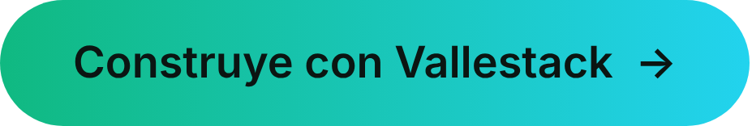

  

# 👋 Hola, soy Luis Carlos Del Valle

### 💻 Desarrollador fullstack · Creador de Vallestack

  <picture>
    <source media="(prefers-color-scheme: light)" srcset="./assets/valle-line-light.png">
    
  </picture>

## 🌱 Sobre mí

Llevo 3 años construyendo tecnología para que los negocios crezcan. Hago **sitios web, aplicaciones móviles y sistemas con base de datos**, de principio a fin: lo que ves en la pantalla y lo que funciona por detrás.

- 🎓 Estudio Ingeniería en Desarrollo y Gestión de Software.
- 📚 He tomado 4 cursos en BIG School (España).
- ⚡ Me apasiona la tecnología y me gusta explicarla sin tecnicismos.
- 🏔️ **Vallestack** es mi marca: tecnología hecha a tu medida, explicada sin tecnicismos y construida para que tu negocio crezca.

  <picture>
    <source media="(prefers-color-scheme: light)" srcset="./assets/valle-line-light.png">
    
  </picture>

## 🧰 Construye con Vallestack

| | Servicio | Lo que obtienes |
|:-:|:--|:--|
| 🌐 | **Sitios web** | Tu negocio en línea, claro y fácil de usar. |
| 🛍️ | **Tiendas en línea** | Un lugar para vender tus productos por internet. |
| 🖥️ | **Aplicaciones web** | Herramientas en el navegador hechas para tu forma de trabajar. |
| 🧩 | **Sistemas a la medida** | Control de ventas, inventario y más, con base de datos. |
| ⚡ | **Automatizaciones** | Menos tareas repetidas y más tiempo para tu negocio. |

  <picture>
    <source media="(prefers-color-scheme: light)" srcset="./assets/valle-line-light.png">
    
  </picture>

## 🛠️ Mi stack

**🎨 Frontend**  

**⚙️ Backend** · APIs REST y autenticación  

**📱 Móvil** · React Native, Kotlin y Android nativo  

**🗄️ Bases de datos**  

**🚀 Herramientas y despliegue**  

**🤖 Inteligencia artificial** · IA aplicada al desarrollo

**🌿 Lo que uso en lo básico**  

  <picture>
    <source media="(prefers-color-scheme: light)" srcset="./assets/valle-line-light.png">
    
  </picture>

## 🚀 Proyectos destacados

### 💎 JoyTec · Sistema para una joyería
🟡 En desarrollo · 🤝 Para un cliente

Una app Android para administrar el acceso y los empleados con roles, conectada a una API que maneja usuarios, clientes, productos, proveedores y compras.

`Android` `Retrofit` `Node.js` `Express` `PostgreSQL` `JWT`

[📱 Ver la app](https://github.com/LuisCarlosDelValle-TI/Joselyn-App) · [🔌 Ver la API](https://github.com/LuisCarlosDelValle-TI/Proyecto_Joytec)

### 💅 AIMAC Studio · Landing para un negocio de belleza
🟢 Publicado · 🤝 Para un cliente

Una página con los servicios, preguntas frecuentes y solicitud de cita por WhatsApp.

`HTML` `CSS` `JavaScript` `Vercel`

[📂 Repositorio](https://github.com/LuisCarlosDelValle-TI/Aimac-Studio) · [🌐 Ver en vivo](https://aimac-studio.vercel.app)

### 🧾 POS · Punto de venta para una joyería
🟡 En desarrollo · 🤝 Para un cliente

Un sistema para llevar el control de las ventas y el inventario del negocio.

`Angular` `NestJS` `TypeScript` `Vercel`

[🖥️ Frontend](https://github.com/LuisCarlosDelValle-TI/pos-front) · [⚙️ Backend](https://github.com/LuisCarlosDelValle-TI/pos-backend) · [🌐 Ver en vivo](https://pos-front-smoky.vercel.app)

### 📊 PanelAdmin · Panel de administración
🎓 Proyecto académico

Un panel de administración hecho en Angular para practicar.

`Angular` `TypeScript` `Vercel`

[📂 Repositorio](https://github.com/LuisCarlosDelValle-TI/dashboard-angular) · [🌐 Ver en vivo](https://dashboard-angular-five.vercel.app)

  <picture>
    <source media="(prefers-color-scheme: light)" srcset="./assets/valle-line-light.png">
    
  </picture>

## 🏪 También emprendo

Tengo un negocio de **recargas, pagos de servicios, copias e impresiones**. Su página la hice yo: [pixelSpace 🌐](https://pixel-space-zeta.vercel.app).

## 📚 Aprende con Vallestack

🔜 **Próximamente:** cursos y ebooks de programación.

  <picture>
    <source media="(prefers-color-scheme: light)" srcset="./assets/valle-line-light.png">
    
  </picture>

## 📈 Mi actividad en GitHub

  
  

  <picture>
    <source media="(prefers-color-scheme: light)" srcset="./assets/valle-line-light.png">
    
  </picture>

## 💬 Cuéntame tu proyecto

Escríbeme con lo que tienes en mente y te respondo con una propuesta. Te explico cada paso sin palabras raras.

  
  

### 🌎 Mis redes

  
  
  
  
  
  
  

  

